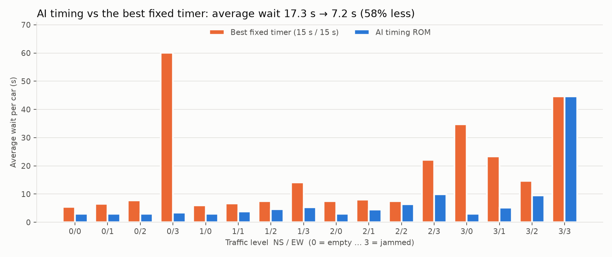
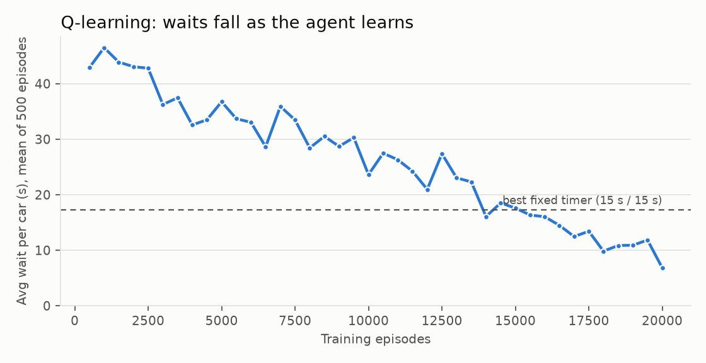

# P6 — Adaptive Traffic Signal Controller

ESC392 Digital Electronics, AI-assisted project P6 (CO2, CO3):
*"Digital FSM handles base sequencing; an AI agent overrides timing based on real/simulated traffic density."*

- **Hardware (Logisim):** a 4-state FSM (two D flip-flops), a 4-bit down-counting timer
  (register + subtractor + MUX), traffic-level inputs and a **timing ROM**, in
  `logisim/traffic_controller.circ`.
- **AI (Python):** a traffic simulator and a Q-learning agent that learns the best green
  time for each of the 16 traffic combinations. Its answers are written into the ROM.
- **Result:** averaged over all 16 traffic combinations, the AI timings cut the average wait
  per car from **17.3 s to 7.2 s (58% less)** compared with the *best* fixed timer that gives
  both roads the same green (15 s / 15 s, found by trying every equal split).
  A typical 9 s / 9 s fixed timer does much worse (33.2 s), because it cannot keep up with
  level-3 traffic: its queues on a jammed road keep growing, so we don't use it as the headline.



## Folder map

| Path | What it is |
|---|---|
| `logisim/traffic_controller.circ` | The circuit to open and demo (generated) |
| `hw/` | Python that generates the circuit (`traffic_controller.py`) and the ROM format (`rom.py`) |
| `ai/` | Traffic simulator, Q-learning agent, report charts |
| `verify/` | Python reference model of the circuit + headless Logisim runner |
| `results/` | Charts, ROM table, AI-vs-fixed comparison, learned policy |
| `docs/state-diagram.md` | State diagram, equations, ROM table (for the report) |
| `docs/logisim-notes.md` | How the generator knows where each component's pins are |
| `tests/` | Automated tests |

## Setup

```bash
python -m venv .venv
.venv/Scripts/python -m pip install -r requirements.txt      # Windows
# source .venv/bin/activate && pip install -r requirements.txt   (macOS/Linux)
```

## Rebuild everything

```bash
.venv/Scripts/python make_all.py          # ~15 s: train, write ROM into the circuit, make charts
```

## Demo in Logisim

1. Open `logisim/traffic_controller.circ` in **Logisim-evolution**. It is tested in
   evolution 3.8.0 and 5.0.0 (the latest release): it opens with no warnings, and the circuit
   matches the Python reference model tick for tick in both (see *Verification*).
2. With the **poke tool** (hand), click the **Traffic_NS** and **Traffic_EW** input pins to set
   each road's traffic level, 0 (empty) to 3 (jammed).
3. **Simulate → Auto-Tick Enabled**. Optionally raise *Simulate → Auto-Tick Frequency*.
   (In Logisim 2.7.1 these are called *Ticks Enabled* and *Tick Frequency*.)
4. Watch the two signal heads. The *AI green NS / EW* displays show the green times the AI
   chose for the current traffic; *seconds left* shows the timer counting down.
5. Change a traffic level mid-cycle: the new time takes effect at the **next** green.
6. **Simulate → Reset Simulation** restarts from NS green. The first NS green after a
   reset lasts 1 tick (see `docs/state-diagram.md`).
7. To show the AI's timings inside the hardware: right-click the **ROM** → *Edit Contents*.
   Each byte is one traffic combination: high digit = NS green, low digit = EW green
   (same table as `results/rom_table.csv`).

Using original Logisim 2.7.1 instead? It places the ROM's pins differently, so rebuild the
circuit for it: `.venv/Scripts/python make_all.py --target 2.7.1`.

The circuit is laid out in five labelled blocks: state register, next-state logic and light
decoder on the top row, the timer in the middle, the timing ROM + MUXes at the bottom. Wires are drawn as **named tunnels**: two tunnels with the
same name are connected.

## How the AI works

- **Simulator** (`ai/traffic.py`): 1-second steps; cars arrive on each road at 0.05 / 0.15 /
  0.30 / 0.45 cars per second for traffic levels 0–3. One car per second leaves a road while
  it has green. Yellow is 2 s.
- **Agent** (`ai/agent.py`): tabular Q-learning. State = (NS level, EW level), 16 states.
  Action = (NS green, EW green) from {3, 5, …, 15} s, 49 actions. Reward = −average wait.
  The traffic level stays fixed within an episode, so this is the one-step (γ = 0) form of
  Q-learning, also called a contextual bandit, with ε-greedy exploration (ε: 1.0 → 0.05).
  20,000 training episodes.
- **Hand-off to hardware:** the best action for each state becomes one ROM byte
  (`results/timing_rom.txt` is the same data as a Logisim memory image).



## Verification

```bash
.venv/Scripts/python -m pytest            # all tests
```

`tests/test_equivalence.py` builds a test version of the circuit and runs it in Logisim
without the window (`-tty table`). It checks that the circuit's state, timer and all six
lights match the Python reference model (`verify/reference.py`) on every tick, for several
traffic settings, in **every Logisim found in `tools/`**. The trained ROM was also checked
on all 16 traffic combinations × 200 ticks in each of them, with no mismatches.

Logisim is not committed. The tests look for (and skip what is missing):

| Put this in `tools/` | Get it from | Java |
|---|---|---|
| `evolution-5.0.0/extracted/` (unzipped) | GitHub *logisim-evolution* releases, `logisim-evolution-5.0.0-windows-amd64.zip` | bundled |
| `evolution-3.8.0/logisim-evolution-3.8.0-all.jar` | same releases page, v3.8.0 | 17+, from `JAVA_HOME` or `LOGISIM_EVOLUTION_JAVA` |
| `logisim-generic-2.7.1.jar` | SourceForge project *circuit*, `2.7.x/2.7.1/` | `java` on the PATH |
