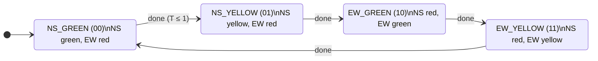

# P6 controller — state diagram, equations and ROM

## FSM state diagram (Moore machine)

Each state holds while the timer counts down; it moves on when `done` = 1.

## State table

| State | S1 S0 | NS light | EW light | Timer loaded on entry |
|---|---|---|---|---|
| NS_GREEN  | 0 0 | green  | red    | gNS from the ROM |
| NS_YELLOW | 0 1 | yellow | red    | 2 s (fixed) |
| EW_GREEN  | 1 0 | red    | green  | gEW from the ROM |
| EW_YELLOW | 1 1 | red    | yellow | 2 s (fixed) |

## Equations

Timer `T` is a 4-bit register (T3..T0) clocked every tick. A subtractor makes `T − 1` and a
2:1 MUX chooses what the register stores next:

- Done: `done = NOT(T3 + T2 + T1)`, i.e. T ≤ 1
- Timer: `T_next = done ? load_val : T − 1`
- Next state (a 2-bit counter that only advances when `done` = 1):
  - `S0' = S0 XOR done`
  - `S1' = S1 XOR (S0 AND done)`
- Next duration (two 2:1 MUXes):
  - `g_next = S1 ? gNS : gEW`
  - `load_val = S0 ? g_next : 2`
  (from S0 = 0 the next state is a yellow; from S0 = 1 it is a green, NS if S1 = 1)
- Lights:
  - `NS_G = ¬S1·¬S0`, `NS_Y = ¬S1·S0`, `NS_R = S1`
  - `EW_G = S1·¬S0`, `EW_Y = S1·S0`, `EW_R = ¬S1`
  (`¬` means NOT; `S0'`, `S1'` above mean the *next* state)

**Start-up:** after reset S = 00 and T = 0, so `done` = 1 straight away. The very first
NS green therefore lasts 1 tick, then NS yellow follows. Every later cycle uses the ROM times.

## Timing ROM (16 × 8 bits)

- Address = `dNS dEW` (2 bits each) → `addr = 4·dNS + dEW`
- Data = `gNS gEW` (4 bits each) → high nibble = NS green seconds, low nibble = EW green seconds

The values are written by `make_all.py` from the trained agent; the current table is in
`results/rom_table.csv`. Last run:

| dNS \ dEW | 0 | 1 | 2 | 3 |
|---|---|---|---|---|
| **0** | 3 / 3 | 3 / 9 | 3 / 9 | 3 / 15 |
| **1** | 9 / 3 | 3 / 3 | 5 / 7 | 5 / 13 |
| **2** | 13 / 3 | 9 / 5 | 9 / 9 | 11 / 15 |
| **3** | 15 / 3 | 13 / 5 | 15 / 11 | 15 / 15 |

(cell = gNS / gEW in seconds)
